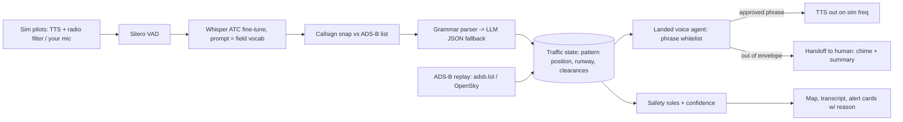

# Landed: hackathon spec
*An AI voice agent that runs traffic at a quiet field, plus a safety net for every call.*
Drafted 2026-10-11. Items marked **[UNVERIFIED]** still need checking before you rely on them.

## 1. Pitch
Landed is an AI radio agent for one quiet place: a **non-towered field's traffic frequency (CTAF) or a single arrival-only runway.** It sequences arrivals using a small, fixed set of approved phrases (a whitelist). Anything outside that set goes to a human. Behind it runs a listener that checks every transmission (readbacks, runway conflicts, similar callsigns, and **what was said vs. where ADS-B shows the aircraft actually is**). Every alert comes with a confidence score and a one-line reason.

Why this is different from prior work: MayDay and Squawk (below) are copilots that listen. Landed's headline is a *bounded voice agent* that talks, with a hard safety envelope. Controllers on r/ATC named arrival-only runways as the low-risk place where they'd accept this (https://www.reddit.com/r/ATC/comments/1vmyqe1/will_ai_eventually_replace_atc/).

**Framing to keep:** this is simulation and demo only. Never transmit on a real aviation frequency (that requires FCC/FAA authorization). The demo frequency is simulated.

## 2. Prior art: what each project used
### MayDay (UC Berkeley AI Hackathon 2025, won the Fetch.ai and Unify prizes)
- Devpost: https://devpost.com/software/mayday-l74dub · writeup: https://medium.com/fetch-ai/mayday-an-ai-safety-net-for-air-traffic-control-built-on-fetch-ai-505dd2e12ce8
- Speech model: `jacktol/whisper-medium.en-fine-tuned-for-ATC`, run on Groq. Audio processed in **5-second chunks** over FastAPI WebSockets.
- Live audio from LiveATC. Agents built on Fetch.ai uAgents/ASI:One. Gemini and Claude parse transcripts. Vapi places phone calls to first responders. Letta keeps an "end shift" handoff memory.
- UI: radar-style Next.js dashboard with aircraft positions, alerts and a comms log.
- Lessons and failure modes: stitching many AI vendors together was the main pain. Live LiveATC streams were unreliable under varying network and audio quality.
- No accuracy or latency numbers published.
- **Code:** public copy at https://github.com/GithubAnant/ai-berkeley-mayday (the original hunter-nguyen/ai-berkeley-2025 returns 404). Cloned to `ref/mayday`. **No LICENSE file, and the GitHub API reports license: null, so it's reference only; don't copy code.**
- What the code actually does:
  - **Audio ingest:** `be/src/atc_audio_agent/core/audio_processor.py` runs `ffmpeg -i $LIVEATC_URL -ac 1 -ar 16000 -acodec pcm_s16le -f wav pipe:1` (default `https://d.liveatc.net/ksfo_twr`). It reads 4 KB at a time and cuts **fixed 5-second chunks** (16000×2×5 bytes), wraps each in a WAV header, and sends it to Groq. It drops the Whisper hallucination "thank you" and broadcasts `{type:"transcript",...}` over a WebSocket on port 8765.
  - **Gotcha, speech model:** `transcribe_groq.py` *names* `jacktol/whisper-medium.en-fine-tuned-for-ATC` (and claims 15.08% word error rate) but **actually calls stock `whisper-large-v3-turbo`** ("fallback used for latency"). Its confidence is a hardcoded `min(1.0+0.15, 1.0)` = **always 1.0**, so it isn't a real confidence.
  - **Gotcha, "formatter" prompt:** `atc_language_agent.py` rewrites garbled transcripts into KSFO phraseology and says *"Never output nonsense - always make educated guesses"*. That is invented content, and unsafe for a safety tool. Landed must do the opposite: null + low confidence.
  - **Parser prompt** (`be/app/agents/atc_agent.py`): JSON with `callsigns[{callsign,airline,flight_number,aircraft_type}]`, `instructions[{type: takeoff_clearance|landing_clearance|taxi|frequency_change|line_up_wait|hold_short, callsign, instruction, runway, details}]`, `runways`, `frequencies`, `weather_info`, `emergencies`, `summary`. Strips markdown code fences before parsing the JSON. Its "confidence" is just high/low depending on whether a callsign was found.
  - **Emergency prompt** (`be/app/agents/emergency_agent.py`): `{has_emergency, severity CRITICAL|HIGH|MEDIUM|LOW, category EMERGENCY|ALERT|WARNING|NONE, emergency_type, description, recommended_actions[], confidence 0-1}` with keyword lists (MAYDAY, PAN-PAN, bird strike…). It polls `messages.json` and writes `emergencies.json`, file-based with no queue.
  - **Human approval before acting:** the AI only *proposes*. The red alert card has a **DISPATCH button** (plus a **`D` hotkey that fires the first undispatched CRITICAL alert with no confirmation**). It calls `POST /api/dispatch {alertId, callsign, emergencyType, description, originalMessage}`, which looks up recipients in `emergency_protocols.json`, fills a script template, and only then calls Vapi `POST https://api.vapi.ai/call`. With no credentials it falls back to a simulated call. The alert is removed after dispatch, and results go to `dispatch_records.json`.
  - **Gotcha:** DISPATCH_SETUP.md lists real-looking +1-650 phone numbers for fire, medical and airport ops. Never point a demo at real numbers.
  - **Frontend:** `MaydayDashboard.tsx` has a status bar on top, a central Leaflet-style `RadarMap` (dynamic import) with FlightRadar24 positions, a right sidebar with tabs (Alerts & Tasks / Live Comms / Shift, the Letta handover), and a `FlightDetails` drawer. `MicrophoneDemo` lets you inject speech from a mic.
  - Everything is hardcoded to KSFO.

### Squawk (Devpost, Sept 2026)
- https://devpost.com/software/atc
- Speech: Whisper fine-tuned on `jacktol/atc-dataset`. **Word error rate on 1,000 held-out clips went from 0.708 to 0.159.** Served with faster-whisper, plus Silero VAD (speech detection), a phraseology prompt, and **callsign snapping** to the list of aircraft actually on frequency.
- Readback checker: a RoBERTa cross-encoder trained on synthetic pairs (**0.894 accuracy, 0.085 false alarm rate, 7 ms per pair**). A deterministic grammar parser runs first, with an LLM only as fallback. The deterministic pipeline takes under 2 seconds per transmission.
- Resolver agent: a hand-rolled tool loop capped at **4 calls and 5 seconds**. Tools: `relisten`, `frequency_history`, `aircraft_track`, `nearby_aircraft`, `sanity_check`. It always ends with `raise_alert`, `dismiss` (with a reason), `mark_uncertain`, or `watch`. Every step is streamed to the screen.
- Data: adsb.lol traffic replay. AI pilots use ElevenLabs voices through a narrow-band radio filter, with **8 injectable error types**. Elasticsearch BM25 search with fuzzy matching (deliberately no vector search).
- UI: deck.gl/MapLibre 3D map, flight strips, a stock-vs-tuned model toggle, and a live scoreboard.
- Lessons and failure modes: stock Whisper hallucinates loops of digits on short noisy clips and can't hear made-up waypoint names. False alarms destroy trust. Comparing meaning beats word-by-word comparison. **Surveillance data fixes most callsign errors.** Synthetic voices hurt accuracy until they mixed sim audio into training.
- Repo URL not shown on the page **[UNVERIFIED]**. License unknown.

### ACRP miscommunication detection (2022)
- https://github.com/andrewda/acrp-miscommunication-detection · paper: https://vsgc.odu.edu/acrpdesigncompetition/wp-content/uploads/sites/3/2022/07/Runway-Safety_Second_Wagstaff-1.pdf
- TypeScript/Vue. Input is uppercase text with numbers spelled out ("TWO NINER ZERO"). The parser outputs `{type: Issuance|Readback, instructions:[{type: Turn|Climb|Descend…, specifiers:[{type: Heading|FlightLevel|Direction…, value}]}]}`.
- Detectors: number transposition, mistaken callsign, incomplete readback. Works on typed-up LiveATC transcripts, no speech recognition.
- **License: none declared** (GitHub API returns null, so all rights reserved). Use it as a design reference only; don't copy the code.

### SESAR HAAWAII (EU research)
- https://www.sesarju.eu/projects/haawaii
- Built for London and Iceland airspace. About 20 hours of manually transcribed audio. Word error rate went from 50% to 25% with 1 hour of training data, and below 10% after more adaptation. The **REDA** readback assistant caught **over 66% of readback errors, with false alarms under 50%** (offline tests, 5 controllers). Also highlighted callsigns while the pilot was still speaking.
- Lesson: adapting to local airspace data matters more than anything else.

### Papers
- Multi-agent LLM with Bayesian fusion: https://dl.acm.org/doi/10.1016/j.eswa.2026.132241. Four agents (syntax, semantics, context, risk) plus explicit safety rules, combined by a Bayesian vote weighted by each agent's reliability. Tested on 894 labeled exchanges from UWB-ATCC (5.8% error rate). **About 90.6% recall, 2.4–4.6% false positives, about 1.6 s latency.** Backends: Gemini 2.5 Flash and Llama-4 Maverick.
- SCOPE: https://arxiv.org/html/2605.29543. A frozen LLM plus a plug-in classifier for unexpected cases, few-shot examples retrieved per case, and "ATC chain-of-thought." **91.05% detection accuracy, 96.63% of bad readbacks corrected,** on a semi-synthetic dataset. (Page timed out on re-fetch, so these figures come from the search abstract.)

## 3. Architecture


### 3.1 Voice agent envelope (hard limits)
- **Can say only** template phrases, filled from typed slots (callsign must be on the ADS-B list, runway must be the active one):
  sequencing ("number two, follow the Cessna on left base"), "runway 27 clear of reported traffic" (advisory only; at a non-towered field it **cannot issue clearances**, matching how a UNICOM/CTAF advisory works), wind/altimeter, "say again", "standby, handing off".
  Arrival-only runway mode adds "cleared to land runway 27" (sim only), only when the runway is unoccupied in state AND ADS-B confirms.
- **The LLM never writes free text that goes on air.** It only picks a template ID and fills slots. The code validates the slots, then TTS speaks the result.
- **Mandatory handoff triggers:** MAYDAY/PAN/emergency keywords, a squawk of 7500/7600/7700 seen on ADS-B, any alert ≥ medium, ASR confidence < 0.6 twice in a row, more than N aircraft in the pattern, an unknown request type, a pilot asking for a human, a runway conflict.
- **Handoff:** the agent says "standby", plays a chime, and the human gets a one-screen summary (aircraft, last 3 transmissions, why it handed off). After that, the agent stops transmitting until it's re-armed.

### 3.1a Approval handoff (pattern borrowed from MayDay, then tightened)
MayDay's pattern is that the AI proposes and a human click triggers the action. Landed applies that to **anything beyond routine advisories**:
1. The agent builds a `Proposal {id, template_id, slots, spoken_text_preview, confidence, reason, evidence[], expires_at (10 s)}`.
2. Routine tier (sequencing, wind, say again) with confidence ≥ 0.8 and no active alert: it auto-speaks, and the action is logged.
3. Approval tier (anything with "land", a go-around, emergency services, any proposal with confidence < 0.8): it shows a card with the exact words that will be spoken. Keys: **A = approve, E = edit slots, R = reject/take over.** Nothing is spoken until approved. **A proposal that expires is dropped, never auto-sent.** Unlike MayDay's one-key `D`, one key always maps to one specific card, and there's a 1-second arm delay so a stray keypress can't fire it.
4. Emergency (MAYDAY/PAN, or a squawk of 7700): the agent locks itself silent, the human owns the frequency, and an optional "notify airport ops" proposal (a simulated Vapi call to a **test number only**) also needs approval.
5. Everything goes to an append-only audit log `{proposal, decision, who, latency_ms}`, which is also the demo's evidence.

### 3.2 Listener rules (each one outputs `{severity, confidence 0–1, reason}`)
1. Readback mismatch (value, runway or callsign compared at the concept level, as Squawk did).
2. Missing readback within 10 s of a hold-short or landing call.
3. Runway conflict: two aircraft cleared for or occupying the same runway, using radio state plus ADS-B.
4. Similar callsigns on frequency at once (edit distance on digits plus phonetic comparison).
5. **Radio vs. ADS-B:** a reported position ("left downwind 27", "5 miles final") that doesn't match the actual track; an altitude readback that doesn't match the observed climb or descent trend over 30 s; a callsign speaking with no matching ADS-B target.
- **Confidence formula:** ASR word confidence × parse confidence × rule-specific evidence (e.g. distance from the reported leg). Alerts under 0.5 show as grey "watch" cards. Every card has one line like "Reported 5 mi final; ADS-B shows 9.2 mi, heading 090 (away)."
- Optional: a 4-call resolver for low-confidence cases, borrowing Squawk's tool-loop idea.

### 3.3 Parser schema (LLM fallback, JSON mode)
```json
{"speaker":"pilot|agent|unknown","callsign":"N123AB","intent":"position_report|request|readback|advisory|emergency|other",
 "runway":"27","leg":"downwind|base|final|crosswind|upwind|null","distance_nm":null,"altitude_ft":null,
 "instructions":[{"type":"land|hold_short|follow|go_around|altitude|heading","value":"..."}],"asr_conf":0.0,"notes":""}
```
Prompt: "Extract only what was said. Use null when unsure. Never infer a callsign that isn't in ACTIVE_CALLSIGNS={...}."

## 4. Reusable assets
| Asset | What it is | Source | License |
|---|---|---|---|
| whisper-medium.en ATC fine-tune | Speech model tuned on ATC | https://huggingface.co/jacktol/whisper-medium.en-fine-tuned-for-ATC | MIT (HF card) |
| jacktol/atc-dataset | Real tower audio + transcripts (Squawk's training set) | https://huggingface.co/datasets/jacktol/atc-dataset | **[UNVERIFIED]**, none on HF API |
| ATCO2 1h sample | Labeled ATC test set | https://huggingface.co/datasets/Jzuluaga/atco2_corpus_1h | **[UNVERIFIED]** |
| UWB-ATCC | Corpus used in the ACM paper | https://huggingface.co/datasets/Jzuluaga/uwb_atcc | CC BY-NC-SA 4.0 (non-commercial) |
| faster-whisper | Fast speech inference | https://github.com/SYSTRAN/faster-whisper | MIT **[UNVERIFIED here]** |
| Silero VAD | Speech segmenting | https://github.com/snakers4/silero-vad | MIT **[UNVERIFIED here]** |
| adsb.lol | ADS-B traffic data | https://www.adsb.lol/ | ODbL **[UNVERIFIED]** |
| LiveATC | Real audio for listening/testing | https://www.liveatc.net/ | Terms restrict redistribution **[UNVERIFIED]**; use local clips only, don't re-host |
| ACRP detectors | Parser and detector design | https://github.com/andrewda/acrp-miscommunication-detection | **No license**: reference only |
| Squawk | Patterns (callsign snapping, tool loop) | Devpost link above | Ideas only |
| MayDay `audio_processor.py` | ffmpeg → 16 kHz mono PCM → WAV → speech-to-text; WebSocket broadcast | github.com/GithubAnant/ai-berkeley-mayday | **No license: reference only** (rewrite; use speech detection instead of fixed 5 s chunks) |
| MayDay `emergency_agent.py` prompt | Emergency JSON schema + keyword lists | same | **No license: reference only** (write your own; add `reason`) |
| MayDay `atc_agent.py` prompt | Parser JSON schema | same | **No license: reference only** |
| MayDay `api/dispatch` + `AlertsAndTasks.tsx` | Propose → human click → Vapi call, simulate if no credentials | same | **No license: reference only** (see 3.1a) |
| MayDay `MaydayDashboard.tsx` | Layout: status bar / map / tabbed sidebar / details drawer | same | **No license: reference only** |
| MayDay `atc_language_agent.py` | "Fill in garbled audio with guesses" formatter | same | **Do not use** (it invents content) |
| Vapi API | Outbound voice calls | https://docs.vapi.ai | Commercial service, terms **[UNVERIFIED]** |

## 5. Day plan (about 9 h)
1. **0–1.5 h:** Fetch the HF model, run it on 10 ATC clips and 5 self-recorded CTAF calls, measure word error rate. Pick one fictional field + runway 27.
2. **1.5–3 h:** Sim: 3 aircraft on scripted ADS-B tracks (or a replayed adsb.lol slice of a small field), TTS pilots through a band-pass filter.
3. **3–4.5 h:** Callsign snapping, grammar parser plus LLM fallback, state table.
4. **4.5–6 h:** Voice agent: template whitelist, slot validator, handoff triggers, TTS out.
5. **6–7.5 h:** Rules 1–5 with confidence and reason. ADS-B check first, since it's the novel one.
6. **7.5–8.5 h:** UI: map with pattern legs, transcript, alert cards, handoff panel.
7. **8.5–9 h:** Rehearse the demo; record a backup video.

## 6. Demo script (3 min)
1. (20 s) Hook: controller shortage. "Quiet fields have no tower at all. Landed is the voice on frequency there, and it knows when to stop talking."
2. (60 s) Two sim aircraft call in. Landed sequences them aloud ("Cessna 3AB, number two, follow the Piper on base"). Each transcript line shows its confidence.
3. (40 s) A pilot reports "5 mile final"; ADS-B shows 9 mi heading away. A red card appears: "Reported 5 mi final; ADS-B 9.2 mi outbound (0.87)". Landed says "say again position."
4. (30 s) A third pilot says "MAYDAY, rough engine." Landed says "standby", plays the chime, and the human panel opens with a summary. The agent goes quiet.
5. (30 s) Show the envelope: a list of the only phrases it can say, a WER chart (stock vs. tuned), and "built on prior art: MayDay, Squawk, HAAWAII; what's new is the bounded talker plus the radio-vs-ADS-B check."

## 7. Risks
- **Speech accuracy on synthetic voices** (Squawk saw this). Mitigation: callsign snapping, a typed-transcript fallback, and testing early.
- **False alarms** (HAAWAII's ran just under 50%). Mitigation: confidence thresholds, grey "watch" cards, the ADS-B check as tie-breaker.
- **Latency:** aim for under 2 s from the end of a call to the alert. Use VAD-segmented utterances, not fixed 5-second chunks.
- **Live-feed flakiness** (MayDay hit this). Also: never let an LLM "fix" a garbled transcript into confident text (MayDay's formatter does this), and never show a fake constant confidence. Run on local recordings and the sim only.
- **Legal/ethics:** never transmit on real frequencies; label it as a sim; respect LiveATC terms and the NC licenses.
- **Credibility:** judges may know MayDay or Squawk. Mention them up front.

## 8. Name riffs
Landed · Landed Tower · Landed CTAF · "Cleared to Landed" · Touchdown by Landed · Landed: Stick the Landing · Landed Wingman · "Landed. Every call."
