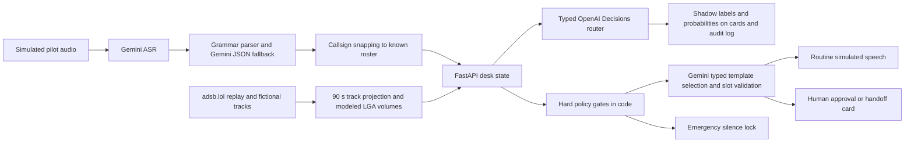

# Landed v2: medevac helicopter voice agent for NYC (hackathon spec)

Updated 2026-10-11 against integration commit `a2a0357` and the canonical decisions on #9 and #24. The original design is in `SPEC-v1.md`. **Pending verification** means the cited material does not establish a current operational fact or permission; **not modeled** means the demo has no corresponding feature. Historical sources retain their dates. **Everything is simulation or replay. Landed never transmits on a real aviation frequency.**

## 0.0 Pitch script (lead with DC)

1. **Open with DC (~30 s).** "January 29, 2025. An Army helicopter and an American Eagle jet collide over the Potomac near Reagan National. 67 people die. The NTSB found one tower controller working both the helicopters and the runway. They were also handling a medical helicopter headed to a hospital, and they were 'a little overwhelmed.' The two crews were on different frequencies and couldn't hear each other. The official finding was 'inadequate traffic advisories, and the lack of safety alerts.'"
2. **Explain the risk.** "In New York, helicopters in the Hudson and East River exclusions self-announce on charted advisory frequencies. The rule requires those pilot calls, but does not require an ATC facility to monitor them. The demo explores whether a separate advisory desk can reduce routine workload and flag a projected conflict."
3. **Introduce Landed.** "Landed is a simulated AI teammate for the controller. It processes pilot audio, cross-checks available ADS-B replay tracks, and handles routine medevac check-ins. When a projected track enters a modeled approach volume, it hands that flight to the human with a reason and a countdown."
4. **Show the demo.** Replay S2: simulated N312LM requests direct College Point area at **600 ft**, crossing the LGA runway 22 final about **1.1 nm** out. The projected-volume alert provides **about 84 s** of warning before entry. This is a DCA-like situation: a helicopter crossing an airliner's short final. Sources: `scenarios/s2.yaml`, `scenarios/SCOREBOARD.md`, and #9 correction.
5. **Close with the honest claim.** "We cannot say Landed would have prevented DC. This simulation demonstrates routine check-ins, an early projected-conflict alert, and a handoff to the human. A commenter on r/ATC suggested routine medevac work as a starting point; we built a bounded demonstration of that idea."

Line that answers "so what": the NTSB's own finding, "the lack of safety alerts." Sources in §0.5. Handle the 67 fatalities with care on slides.

## 0. The use case in one line

Landed demonstrates **routine medevac helicopter advisories in NYC river corridors**, with human handoff for projected conflicts in modeled LGA volumes. JFK and EWR protection is **not modeled**. Sources: `geo/SOURCES.md`, `agent/landed_agent/policy.py`.

> "Medevac helicopters coming in and out of the airspace and not crossing any arrival or departure paths?"
>
> A commenter on r/ATC, [original comment](https://www.reddit.com/r/ATC/comments/1vmyqe1/comment/p3gkv7x/).

**Verification:** #23 records the comment as verified. The author's professional role remains **pending verification**; describe them only as a commenter, not as a verified controller.

## 0.5 Pitch and framing

**Selling point.** Landed demonstrates routine medevac advisories and early projected-conflict flags. **The human makes every hard decision.** Safe operational use and reduced controller workload remain hypotheses to test, not measured outcomes.

**Analogy.** A bounded assistant handles routine simulated river legs and asks the controller to take over before a modeled approach conflict. Landed issues advisories; it does not fly the helicopter.

**The measured demo window.** Saturday, October 10, 2026, **11:00 to 11:15 a.m. Eastern**, with **17 real helicopters** in the background replay and fictional scenario tracks overlaid. S2 uses N312LM at 600 ft toward College Point area, about 1.1 nm from runway 22, with about 84 s to projected-volume entry. The scoreboard records 83.109375 s for the pinned S2 run; "about 84 s" is the canonical rounded demo wording. This is not an actual medevac incident or a claim about LGA overnight staffing. Sources: `scenarios/s2.yaml`, `scenarios/SCOREBOARD.md`, #9.

### What's built

- **Replay desk and conflict engine:** map, replay controls, modeled LGA volumes, projected paths, reason/countdown cards, and one alert per aircraft. Default runway configuration: arrivals 22, departures 13. Sources: `app/src/engine/conflictEngine.ts`, `app/src/engine/runwayConfig.ts`, `replay/build_replay.py`.
- **Speech and bounded voice agent:** Gemini ASR, callsign snapping, grammar parser with Gemini JSON fallback, validated templates, simulated speech, approval/edit/reject flow, emergency silence lock, and audit log. Sources: `speech/asr.py`, `speech/parse.py`, `agent/landed_agent/agent.py`, `server/landed_server/hub.py`.
- **Typed decision router:** OpenAI Decisions is live in the configured demo in **shadow mode**. It labels/logs radio calls and annotates cards without changing the policy tier. TypeSafe AI Jev and Gemini router adapters also exist. Hard safety rules stay in code; routing thresholds are not validated for enforcement. Sources: `agent/landed_agent/router.py`, `agent/landed_agent/agent.py`, #24 router status. Provider availability depends on runtime configuration; a keyless clone does not run the live router.

### Canonical demo evidence

- **Seven scored scenario variants:** S1 to S6, with S3A/S3B, pass **3 out of 3 with the server: 7/7, 236 checks, 0 failures, 0 gaps**. These use pinned ASR and prewarmed, validated choices; cached response times are not live model latency. Sources: `scenarios/SCOREBOARD.md`, #24 final result. The app has a scenario picker and scoreboard (`app/src/components/ScenarioPicker.tsx`).
- **Canonical background replay result:** **0 false approach or departure handoffs across 17 real helicopters in the demo window (Sat Oct 10, 11:00 to 11:15 ET)**; **6 Class B floor handoffs** and **5 Class B floor cautions**. The six are flagged for the controller, not labeled violations: the replay does not expose clearances. This is one 15-minute snapshot, not an operational false-alarm rate. Sources: `app/src/engine/conflictEngine.test.ts`, #24 canonical counts.
- **Speech evidence:** `speech/RESULTS.md` reports all #3 gates passed: 50/50 valid JSON outputs, 0.89 s median forced-LLM parse latency (p95 1.13 s), and reasons on 400/400 synthetic parses. Gemini ASR has **2.4% WER on 150 clean synthetic clips** and **33.2% WER on 100 real ATCO2 clips**. Synthetic scripts overlap the parser's design bank; European ATCO2 audio is a stress test, not NYC accuracy. License confirmation remains pending (#29); no permission to redistribute the dataset is implied.

**Planned or incomplete:** stated-intent extension of the 90 s projection, full SFRA corridor-rule enforcement (#15), JFK/EWR protection, continuous live-frequency ingestion, and real dispatch integrations. Parsed calls already affect agent policy and handoff cards; they do not steer the geometric projection. Sources: `app/src/engine/conflictEngine.ts`, `agent/landed_agent/policy.py`, #24 scope.

**Workload hypothesis (not operationally measured).**

- *Without it:* every helicopter check-in, position report and traffic call competes for the same controller's attention as the airliners. Conflicts get noticed when they show up visually or on radar alerts, often late.
- *Freed attention:* the demo counts simulated autonomous transmissions. Any reduction in real controller workload remains unmeasured.
- *Earlier warnings:* the geofence flags a projected ADS-B track entering a modeled volume. Parsed requests independently inform the agent handoff; intent-based geometric projection is planned.
- *Capacity:* whether routine automation frees controller capacity requires a workload study; the demo establishes no equivalent staffing gain.

**Counterfactual: the January 29, 2025 midair collision near DCA (PAT25 / American Eagle 5342).** Official sources only:

- **What happened:** an Army UH-60L (callsign PAT25) and PSA Airlines flight 5342 (CRJ700) collided about 0.5 mi SE of DCA at about 2048 EST. **All 67 people aboard both aircraft died.** Source: NTSB final report AIR-26-02: https://www.ntsb.gov/investigations/AccidentReports/Reports/AIR2602.pdf
- **One controller on combined positions:** "the DCA local control (LC) controller was working both the LC and helicopter control (HC) positions." The positions had been combined at 1540 that day. The aircraft were on separate frequencies (tower 119.1, helicopter 134.35), so neither crew could hear the other's transmissions. Source: Preliminary report: https://www.ntsb.gov/investigations/Documents/DCA25MA108%20Prelim.pdf · Chair Homendy's testimony (Feb 12, 2026): https://www.ntsb.gov/news/Testimony/Pages/Homendy-20260212.aspx. The NTSB also found staffing numbers were adequate under FAA rules; the problem was combining the positions. Human performance presentation: https://www.ntsb.gov/investigations/Documents/3_ATC%20Human%20Performance%20Presentation.pdf
- **Workload:** the controller was "a little overwhelmed" 10–15 minutes before the accident, and traffic increased about 90 s before it (same presentation). In the final minutes the controller was also handling other helicopters, including **MEDI 1, a medical helicopter requesting a route to INOVA Fairfax Hospital**, and Muscle 7. Source: NTSB History of Flight performance study: https://data.ntsb.gov/Docket/Document/docBLOB?FileExtension=pdf&FileName=DCA25MA108_HistoryofFlight_PerformanceStudy-Rel.pdf&ID=19018226
- **Route and altitude:** PAT25 flew Route 1 south along the Potomac onto **Route 4**. Flight 5342 had agreed to switch from runway 1 to runway 33, circling to land. Route 4's maximum authorized altitude in that segment was **200 ft**. At that altitude, a helicopter could have only **about 75 ft** of vertical separation from an airplane on the runway 33 approach. The collision happened at **about 278 ft** (helicopter radio altitude, steady for 5 s). Source: NTSB urgent recommendations press release: https://www.ntsb.gov/news/press-releases/Pages/NR20250311.aspx · prelim · final report
- **Alerts and timeline:**
  - Before the conflict alert, the controller gave PAT25 a traffic advisory. PAT25 reported the traffic in sight and requested visual separation, which was approved (final report).
  - **2047:33 (26 s before impact):** the conflict alert first activated. Source: [NTSB ATC presentation, slide 16](https://www.ntsb.gov/investigations/Documents/2_Air%20Traffic%20Control%20Presentation.pdf).
  - **2047:39 (20 s before impact):** the tower asked PAT25 whether it had the CRJ in sight. **A conflict alert was audible in the background.**
  - **2047:40:** the CRJ's TCAS called "Traffic, Traffic." The aircraft were about **0.95 nm** apart.
  - **2047:42:** "pass behind the CRJ" was transmitted. A **0.8-second mic key from the helicopter blocked** the "pass behind" portion.
  - PAT25 again requested visual separation, which was approved.
  - **Collision at 2047:59.**
  Sources: prelim · NTSB Feb 14, 2025 briefing: https://www.ntsb.gov/investigations/Documents/Feb.14.2025_Briefing_Mid-air_Collision%20near%20DCA.pdf · performance study
- **Official causes (summary):** the FAA placed a helicopter route too close to a runway approach path and didn't act on known risk; the air traffic system relied too heavily on pilot-applied visual separation; the helicopter crew's visual separation wasn't effective; *"the tower team's loss of situation awareness and degraded performance due to the high workload of the combined helicopter and local control positions"* led to "inadequate traffic advisories, and the lack of safety alerts to both flight crews"; and the Army didn't make sure pilots understood altimeter error tolerances. Limits of the onboard traffic and collision alerting systems were a contributing factor. Source: https://www.ntsb.gov/investigations/Pages/DCA25MA108.aspx
- **FAA actions afterward:**
  - **Feb 19, 2025:** temporary NOTAM FDC 5/4379 restricting helicopters over the Potomac near DCA (cited in NTSB AIR-25-01: https://www-s.ntsb.gov/investigations/AccidentReports/Reports/AIR2501.pdf).
  - **Mar 11, 2025:** NTSB urgent recommendations A-25-1/-2, to prohibit Route 4 between Hains Point and the Wilson Bridge when runways 15/33 are in use, and to designate an alternative route.
  - **Mar 14, 2025:** the FAA **permanently closed Route 4 between Hains Point and the Wilson Bridge**, restricted non-essential helicopter flights, and eliminated mixed helicopter/fixed-wing traffic. Urgent missions (lifesaving medical, priority law enforcement, presidential) get specific separation distances. The FAA also barred simultaneous use of runways 15/33 and 4/22 when those urgent missions are operating nearby. Source: https://www.faa.gov/newsroom/faa-statement-ntsb-recommendations-dca
- **Final report adopted January 27, 2026:** NTSB AIR-26-02. Sources: [NTSB investigation and board presentations](https://www.ntsb.gov/investigations/Pages/DCA25MA108.aspx), [board-meeting summary published January 28](https://www.ntsb.gov/news/press-releases/Pages/NR20260127.aspx).
- **How to frame it:** Landed demonstrates the type of projected-conflict alert and human handoff motivated by the DCA findings. **No DCA replay or prevention counterfactual has been validated.** Do not claim that this build would have alerted before DCA's 26-second conflict alert, prevented the collision, or changed a crew/controller response. Structural causes included route design, visual separation, workload, and altimeter awareness. Be respectful: 67 people died. Sources: NTSB AIR-26-02 and the ATC presentation above.

### 0.6 Design motivation: monitoring advisory calls

**Who talks to whom in the NYC river corridors**

- **Within the river exclusions, the rule requires self-announced position reports.**
  - 14 CFR §93.351(c) requires pilots in the Hudson/East River Exclusions to "self announce position on the appropriate radio frequency… as depicted on the New York VFR Terminal Area Chart." §93.352 adds mandatory Hudson reporting points (type, position, direction, altitude). https://www.ecfr.gov/current/title-14/chapter-I/subchapter-F/part-93/subpart-W
  - The FAA SFRA kneeboard and course list **Hudson CTAF 123.05** and **East River CTAF 123.075**. Hudson reporting points: Alpine Tower, GWB, Intrepid, Clock, Statue of Liberty, VZ. East River has no required points; Williamsburg Bridge and Governors Island are recommended.
    - Kneeboard: https://www.faasafety.gov/files/gslac/library/documents/2010/Nov/48447/kneeboard.pdf
    - Course: https://www.faasafety.gov/files/gslac/courses/content/79/776/NY%20Airspace%20Text%20Only%20R2%20-072010.pdf
    - Both are **2010 documents**, and the course says "this information is subject to change," so check the current NY TAC / Helicopter Route Chart **Pending current-chart verification (#29); historical values only**. (This supersedes the "Hudson CTAF not cited" note in §1.2.)
  - The CFR text **doesn't require** helicopters to contact ATC inside the exclusions. Only *airplanes* need LGA Tower authorization in the East River segment (§93.353). Whether an ATC facility monitors these frequencies in practice is **pending operational verification**; no public monitoring log was checked. By rule it's a pilot-to-pilot advisory frequency.
- **When LGA Tower and helicopter controllers get involved:**
  - Leaving the exclusion: climbing into Class B (above 1,300 ft MSL over the Hudson per the FAA course) requires a Class B clearance.
  - Airplanes transiting the East River segment (LGA Tower 126.05/263.00 before Governors Island, per the kneeboard).
  - Skyline routes: southbound on 126.05 (LGA), northbound on 127.85 (EWR), per the kneeboard.
  - Operating to or from LGA's surface area. A VATSIM (flight-sim network) SOP describes helicopters handed to LGA Local at least 3 nm out, and departures via the Triborough or Throgs Neck Bridge (https://wiki.nyartcc.org/wiki/LGA_SOP). **Simulation reference only; not verified as an FAA procedure and not used as a routing authority.**
  - LiveATC lists a separate "KLGA Tower (TCA/Heli)" feed; this label alone does not verify current staffing: https://www.liveatc.net/hlisten.php?icao=klga&mount=klga_twr2
- **Is one controller often working both helicopters and runway traffic?**
  - FAA facility rules allow positions to be "consolidated in consideration of activity." They say non-local functions "must not be consolidated/combined at the local control position **except during periods of significantly reduced traffic levels**." Midnight shifts must have **no fewer than two** certified controllers "unless no such personnel are available," and functions are *expected* to be consolidated during midnight shifts to allow breaks. Source: FAA JO 7210.3, Ch. 2 §6: https://www.faa.gov/air_traffic/publications/atpubs/fac/0206.html
  - Historical evidence: a 2007 DOT Inspector General review found 3 of 62 combined facilities scheduling one controller on midnights on the date of the Comair crash, and found controllers "combining all open positions and alternating between breaks." https://www.oig.dot.gov/sites/default/files/av2007038.pdf. A follow-up found compliance with the new two-controller policy: https://www.oig.dot.gov/library-item/29198
  - DCA (Jan 29, 2025): helicopter control and local control were combined at 1540 that day, during busy evening traffic (§0.5).
  - **LGA-specific frequency of combined staffing is pending verification and excluded from the demo claim.** I found no public LGA position log data. The fair claim is "combining positions is allowed and does happen, at night and sometimes under load," not "it's routine at LGA."

**How to frame it for Landed**
On the river corridors, pilots self-announce on charted CTAFs. The regulation requires pilot reports but does not establish whether controllers listen in practice. **The demo processes simulated pilot audio and ADS-B replay, then checks modeled LGA protected volumes.** Continuous live CTAF monitoring is planned; no live aviation transmission occurs. The NTSB combined-workload findings motivate this design without establishing an LGA workload result. Sources: §93.351(c), §0.5, `speech/asr.py`, `app/src/engine/conflictEngine.ts`.

## 1. NYC facts (cited)

### 1.1 Heliports and hospital helipads

| Site | ID | Published coordinates | Notes | Source |
|---|---|---|---|---|
| East 34th Street Heliport (next to NYU Langone/Bellevue) | 6N5 | 40-44-32.81N 073-58-19.64W (40.7424472, -73.9721222) | 4 pads; **CTAF/UNICOM 123.075; App/Dep 120.8** (A/FD); "all ops over East River"; closed Sat/Sun; 4.3 nm SW of LGA | https://www.airnav.com/airport/6N5 · A/FD https://skyvector.com/files/tpp/2504/afdpdf/NE_225_17APR2025.pdf |
| Downtown Manhattan/Wall St (Downtown Skyport) | JRB | 40-42-04.369N 074-00-32.502W (40.7012136, -74.0090283) | Public use, no tower; A/FD lists N40°42.07′ W74°00.54′ | https://airnav.com/airport/JRB |
| University Hospital Rooftop, Newark (Level I trauma, near EWR) | NJ87 | 40-44-27.05N 074-11-27.03W | Private, medical use; elevation 237 ft | https://airnav.com/airport/NJ87 |
| Staten Island University Hospital | NY52 | 40-35-03.13N 074-04-59.74W | Private, medical use | https://airnav.com/airport/NY52 |
| Bellevue Hospital (building) | n/a | Not used as a heliport coordinate | Hospital-to-6N5 relationship pending verification; no rooftop-pad claim | Secondary listing from the original draft; excluded from map data (`geo/SOURCES.md`) |
| Other Manhattan hospital rooftop pads | n/a | Not modeled | No published FAA record verified for this build | Pending verification; excluded (`geo/SOURCES.md`) |
West 30th St Heliport (JRA): **pending FAA/AirNav record verification; excluded from the map**. Source to check: [AirNav JRA](https://www.airnav.com/airport/JRA); exclusion recorded in `geo/SOURCES.md`.

### 1.2 Hudson and East River SFRA (14 CFR 93 Subpart W)

Source: https://www.ecfr.gov/current/title-14/chapter-I/subchapter-F/part-93/subpart-W, §93.352 at https://www.law.cornell.edu/cfr/text/14/93.352, FAA course https://www.faasafety.gov/files/gslac/courses/content/79/776/NY%20Airspace%20Text%20Only%20R2%20-072010.pdf

- **Hudson Exclusion:** from the surface up to, but not including, the Class B floor, between the riverbanks. It runs from near Alpine Tower (40°57′45″N 73°54′48″W) south to the Verrazano-Narrows Bridge (full boundary in §93.350(d)). Pilots fly the **west shoreline southbound and the east shoreline northbound**, self-announce type, position, direction and altitude at the charted reporting points, and transit at **1,000 ft MSL or higher**, below the Class B floor (1,300 ft MSL in the demo, sourced in `geo/SOURCES.md`). The [2026 FAA Area K description](https://www.federalregister.gov/documents/2026/07/31/2026-15552/amendment-of-class-b-airspace-new-york-ny) retains that floor but takes effect **October 29, 2026**, after the replay date; it is not itself an in-force October 10 chart. The 2010 FAA course corroborates the value; the chart edition applicable to the replay remains **pending verification (#29)**.
- **East River Exclusion:** below 1,500 ft MSL from 40°38′39″N 74°02′03″W, past Governors Island, up to the **LGA VOR/DME 6-mile arc**. From that arc to the north tip of Roosevelt Island it drops to **1,100 ft MSL and below**. Fixed-wing airplanes need ATC authorization. The FAA course says to call LaGuardia Tower **before Governors Island on 126.05**. That's a 2010 document: **Pending current-chart verification (#29); historical values only**.
- Hudson CTAF 123.05 / East River CTAF 123.075 per the 2010 FAA kneeboard (see §0.6). Check against the current TAC **Pending current-chart verification (#29); historical values only**.

### 1.3 Airport layouts and facilities that matter

- **LGA:** runways **4-22 and 13-31** (FAA COPTER ILS 22 plate). **LaGuardia Tower 118.7**, NY Approach 120.8, ground 121.7. A helicopter-only **COPTER ILS/LOC RWY 22** comes in via PROUD on LGA R-225, course 224°, with speed limits of 70–90 KIAS. Runway 31 has the **RNAV (GPS) X RWY 31**, which ends with a visual segment with turns (DRRYL → KEYTH → DCTRK → 314°). These are the arrival paths the agent must not cross.
  Plates: https://aeronav.faa.gov/d-tpp/2609/00289copteril22.pdf · https://aeronav.faa.gov/d-tpp/2610/00289rx31.pdf
- **Who handles helicopters:** LiveATC carries a separate **"KLGA Tower (TCA/Heli)"** feed (https://www.liveatc.net/hlisten.php?icao=klga&mount=klga_twr2), a feed label that does not establish current staffing or operating procedures. New York TRACON (**N90**) runs approach. A VATSIM (flight-sim network) SOP describes helicopter departures via the Triborough or Throgs Neck Bridge at 1,000 ft, notes that parts of the East River, Throgs Neck and Flushing are uncontrolled, and says helicopters landing at LGA are handed to Local at least 3 nm out (https://wiki.nyartcc.org/wiki/LGA_SOP). **Simulation reference only; real-world procedure pending FAA verification and excluded from the demo routing model.**
- **JFK and EWR:** runway layouts remain **pending FAA-diagram verification; protected volumes are not modeled or shown as working protection**. Sources: `geo/SOURCES.md`, `app/public/data/geo/protected_volumes.geojson`.

### 1.4 MEDEVAC rules (FAA JO 7110.65 §2-1-4)

Sources: [current FAA JO 7110.65, 2-1-4b(1)](https://www.faa.gov/air_traffic/publications/atpubs/atc_html/chap2_section_1.html); historical terminology change: [FAA N7110.607](https://www.faa.gov/documentLibrary/media/Notice/N7110.607.pdf).

- **"Lifeguard" was replaced by "MEDEVAC"** (effective Nov 15, 2012). Say "Lifeguard" only in historical context.
- Controllers give civil air ambulance flights priority handling when the pilot verbally identifies the flight with MEDEVAC plus the authorized callsign or full civil registration. Flight-plan remarks alone do not establish operational priority. Controllers use judgment to expedite the flight; this does not authorize the demo to sequence fixed-wing traffic. Source: JO 7110.65 2-1-4b(1).
- An **aircraft in distress has the right of way over all other traffic** (§2-1-4a).
- Phraseology: civilian air ambulance = "MEDEVAC" + registration, e.g. "**MEDEVAC Two Six Four Six X-Ray**". An air carrier ambulance uses "MEDEVAC" + callsign, e.g. "MEDEVAC Delta Fifty-One."
- Design consequence: **priority ≠ autonomy.** A MEDEVAC flight needing priority *against fixed-wing traffic* is exactly a case that needs a human sequencing decision, so Landed hands it off.

### 1.5 Data sources

- **adsb.lol:** replay data is licensed under **ODbL 1.0**, verified in the [provider OpenAPI metadata](https://api.adsb.lol/api/openapi.json) and [API docs](https://api.adsb.lol/docs). Attribution: ADS-B data © adsb.lol contributors, licensed under the [Open Database License 1.0](https://opendatacommons.org/licenses/odbl/1-0/). Publicly released derived replay databases also carry ODbL; see `NOTICE.md`.
- **OpenSky Network:** candidate source only, not used by the demo. **Terms pending verification; no permission inferred.** [Provider site](https://opensky-network.org/).
- **LiveATC:** reference feed listings only. **Terms pending verification; no LiveATC audio is used or redistributed by Landed.** Sources: [provider site](https://www.liveatc.net/), `speech/DATA.md`.

## 2. Product: implemented boundaries

The simulated desk handles check-ins, position reports, and routine traffic advisories for up to three helicopters. Gemini selects from typed templates; code validates the slots and controls auto/approval/handoff behavior. The desk never issues Class B, runway, or approach clearances. Sources: `agent/landed_agent/templates.py`, `agent/landed_agent/policy.py`.

**Modeled volumes:** LGA runway 22 final, runway 31 approach/visual legs, runway 4/13 straight departure placeholders, and the Hudson Class B floor. Runway 31 fix positions come from FAA CIFP cycle 2610; widths and altitude envelopes remain demo modeling choices. Departure corridors follow runway headings, not verified FAA departure procedures. JFK/EWR volumes are not modeled. Sources: `geo/SOURCES.md`, `app/public/data/geo/approach_paths.geojson`, `app/public/data/geo/protected_volumes.geojson`.

**Projection:** constant ground speed, track, and smoothed vertical rate over **90 s**. Only configured arrival/departure volumes are active. Current smoothed altitude at or above the Class B floor minus **100 ft** triggers a handoff within the lateral polygon; a sustained projected climb toward that margin produces a caution. No clearance record is available, so these are controller flags, not violation findings. Source: `app/src/engine/conflictEngine.ts`.

**Mandatory policy triggers:** protected-volume handoff alert; reported/ADS-B altitude at the configured floor margin; out-of-whitelist request; emergency text or squawk 7700/7600/7500; ASR confidence below **0.6** twice; unresolved callsign ambiguity after a retry; weather/IMC language; requested Hudson transit altitude below the sourced **1,000 ft** minimum; or a fourth helicopter on the desk. The spoken request can trigger a handoff even before a geometric conflict. Sources: `agent/landed_agent/policy.py`, `scenarios/s2.yaml`, `scenarios/s3.yaml`.

### 2.1 Approval and emergency handoff

1. The agent proposes a typed template with slots, preview, confidence, reason, and evidence. Routine calls with confidence **at least 0.8**, no active alerts, and no hard trigger can speak automatically.
2. Confidence **0.5 to below 0.8**, an active alert, or a nonroutine proposal requires a human card. Below **0.5**, policy hands off. First low-ASR/ambiguous calls can instead force `SAY_AGAIN` without guessing the registration.
3. Approval cards support **A = approve, E = edit, R = reject/take over**, with a **1 s** arm delay and **10 s** expiry. Expired/rejected proposals do not speak. Editing re-arms the card.
4. An emergency produces one `CONTROLLER_TAKING_OVER` handoff and a desk-wide silence lock; subsequent automatic speech is suppressed. Engine emergency squawks and text checks supplement the parser. This is independent of the parser's emergency flag, **not proof that a missing emergency word in ASR can always be recovered from audio**. Heliport-ops notification is a proposal only; no real dispatch integration is built.
5. The server records proposals and decisions in its audit log. Sources for this flow: `agent/landed_agent/agent.py`, `agent/landed_agent/policy.py`, `server/landed_server/hub.py`, `qa/check_server.py`, `scenarios/SCOREBOARD.md`.

### 2.2 Confidence and remaining checks

**Engine confidence** = `freshness × (0.65 × depth + 0.35 × stability)`. Depth measures geometric penetration/proximity, stability measures recent heading variation, and freshness gates stale ADS-B data. **Agent confidence** separately combines ASR, parse, and available geometric evidence. Neither score is a calibrated operational safety probability. Sources: `app/src/engine/conflictEngine.ts`, `agent/landed_agent/policy.py`, `speech/RESULTS.md`.

Shoreline-direction cautions and ADS-B position hints for ambiguous callsigns are demonstrated in S3B/S4. Full corridor-rule enforcement (#15), generalized readback checking, and intent-driven route projection remain planned. Sources: `scenarios/SCOREBOARD.md`, `scenarios/scn_engine.py`, #24 freeze scope.

## 3. Built architecture

Sources: `speech/parse.py`, `agent/landed_agent/agent.py`, `agent/landed_agent/router.py`, `server/landed_server/app.py`. The configured demo uses OpenAI Decisions in shadow mode; adapters for Jev and Gemini also exist. Router enforcement is opt-in code, not validated demo behavior. Whisper and Silero are prior-art candidates (§9/§10), not the shipped ASR path.

## 4. Demo scenarios

All scenario registrations are fictional and the channel is **SIM DESK**. `scenarios/SCOREBOARD.md` is the measured source; example speech below describes the scenario, not a new confidence measurement.

| Scenario | Demonstrated behavior | Source |
|---|---|---|
| S1: routine JRB to 6N5 | N2646X at 500 ft checks in and reports along the East River; four autonomous transmissions, no handoff | `scenarios/s1.yaml` |
| S2: LGA runway 22 crossing | N312LM requests direct College Point area at 600 ft. `STANDBY_HANDOFF` returns control; the projected track crosses the final about 1.1 nm out with about 84 s warning | `scenarios/s2.yaml`, `replay/build_replay.py` |
| S3A: weather/descent | A request to descend to 600 ft on the Hudson with ceilings coming down triggers weather, below-transit-minimum, and out-of-whitelist handoff | `scenarios/s3.yaml` |
| S3B: silent drift | Wrong-shoreline geometry plus opposing traffic produces a `TRAFFIC` advisory in the scripted runner | `scenarios/s3.yaml`, `scenarios/scn_engine.py` |
| S4: confusable callsigns | N2646X/N2464X ambiguity produces `SAY_AGAIN`, then handoff on a repeated ambiguity; the card includes an ADS-B position-match hint, not a voice identity confirmation | `scenarios/s4.yaml` |
| S5: emergency | MAYDAY and simulated 7700 produce one takeover call and a silence lock; no subsequent automatic transmissions | `scenarios/s5.yaml` |
| S6: capacity | The fourth helicopter is handed off; the first three remain on the desk | `scenarios/s6.yaml` |

**S2 wording:** "MEDEVAC Three One Two Lima Mike, standby, controller will be with you." The normalized registration is **N312LM**, including Mike, even though the scripted input abbreviates the spoken callsign. This is a **DCA-like situation: a helicopter crossing an airliner's short final**, not identical DCA geometry. A medical-priority request that affects fixed-wing sequencing belongs to the human (§1.4).

The canonical outcome is **S1 to S6 pass 3 out of 3 with the server: 7/7, 236 checks, 0 failures, 0 gaps**. These repeat cached/pinned demo choices; they are not seven independent real-world safety trials. Source: `scenarios/SCOREBOARD.md`, #24.

## 5. What the demo establishes

The build demonstrates bounded simulated speech, deterministic hard handoffs, human approval/expiry behavior, and an emergency lock. The learned typed router annotates decisions in shadow mode. The 17-helicopter background snapshot produced zero false approach/departure handoffs in the stated 15-minute window; it does not establish an operational false-alarm rate or detection recall. Sources: §0.5, `scenarios/SCOREBOARD.md`, `app/src/engine/conflictEngine.test.ts`.

Controller workload reduction, capacity gains, safe autonomy, continuous live radio operation, and collision prevention require further validation. No LiveATC audio is used. Sources: `speech/DATA.md`, `docs/QA.md`.

## 6. Run and inspect the build

The judge startup instructions belong in the top-level `README.md` (#30/#38). Inspect `scenarios/SCOREBOARD.md` for scenario evidence, `speech/RESULTS.md` for speech gates and limitations, `geo/SOURCES.md` for geometry provenance/approximations, and `docs/QA.md` for independent QA. This spec records build status on the integration branch; the final public snapshot depends on #39 reaching main.

## 7. Verification limits

- **Current-chart verification pending (#29):** CTAF frequencies and the chart edition applicable to the replay. The 2010 FAA kneeboard values are historical; the Area K final rule cited in §1.2 takes effect after the replay. Use SIM DESK on stage.
- **Operational verification pending:** LGA staffing frequency, actual advisory-frequency monitoring, VATSIM procedures as real FAA procedures, and hospital-pad relationships. These are excluded from demonstrated claims.
- **Not modeled:** JFK/EWR protection, JRA, and unverified Manhattan rooftop pads. LGA departure envelopes and approach widths/altitude bands are approximate demo geometry, not certified obstacle/protection surfaces.
- **License confirmation pending (#29):** ATCO2 evaluation/public-hackathon scope. Do not redistribute its recordings/transcripts. Other candidate-source terms are labeled in §10; the presence of a link is not permission.
- **Historical prior art:** §9 describes other projects and their reported metrics. Those figures are not Landed results. No unlicensed reference code is part of the demo tree; history cleanup is a separate post-submission task (#22), not completed by this docs edit.

## 8. Name riffs

Landed · Landed Medevac · Landed Helo Desk · "Landed: clear skies for the ones who can't wait" · Landed Rotor · Landed Corridor · Touchdown by Landed

## 9. Appendix: prior art (from v1): what each project used

These are historical research notes and third-party reported results, not Landed implementation or independently reproduced performance. Local `be/` and component paths below refer to those upstream projects, not files in this snapshot.

### MayDay (UC Berkeley AI Hackathon 2025, won the Fetch.ai and Unify prizes)

- Devpost: https://devpost.com/software/mayday-l74dub · writeup: https://medium.com/fetch-ai/mayday-an-ai-safety-net-for-air-traffic-control-built-on-fetch-ai-505dd2e12ce8
- Speech model: `jacktol/whisper-medium.en-fine-tuned-for-ATC`, run on Groq. Audio processed in **5-second chunks** over FastAPI WebSockets.
- Live audio from LiveATC. Agents built on Fetch.ai uAgents/ASI:One. Gemini and Claude parse transcripts. Vapi places phone calls to first responders. Letta keeps an "end shift" handoff memory.
- UI: radar-style Next.js dashboard with aircraft positions, alerts and a comms log.
- Lessons and failure modes: stitching many AI vendors together was the main pain. Live LiveATC streams were unreliable under varying network and audio quality.
- No accuracy or latency numbers published.
- **Code:** public copy at https://github.com/GithubAnant/ai-berkeley-mayday (the original hunter-nguyen/ai-berkeley-2025 returns 404). Previously inspected in `ref/mayday`; removed from the demo tree, with history cleanup tracked separately in #22. **No LICENSE file, and the GitHub API reports license: null, so it's reference only; don't copy code.**
- What the code actually does:
  - **Audio ingest:** `be/src/atc_audio_agent/core/audio_processor.py` runs `ffmpeg -i $LIVEATC_URL -ac 1 -ar 16000 -acodec pcm_s16le -f wav pipe:1` (default `https://d.liveatc.net/ksfo_twr`). It reads 4 KB at a time and cuts **fixed 5-second chunks** (16000×2×5 bytes), wraps each in a WAV header, and sends it to Groq. It drops the Whisper hallucination "thank you" and broadcasts `{type:"transcript",...}` over a WebSocket on port 8765.
  - **Gotcha, speech model:** `transcribe_groq.py` *names* `jacktol/whisper-medium.en-fine-tuned-for-ATC` (and claims 15.08% word error rate) but **actually calls stock `whisper-large-v3-turbo`** ("fallback used for latency"). Its confidence is a hardcoded `min(1.0+0.15, 1.0)` = **always 1.0**, so it isn't a real confidence.
  - **Gotcha, "formatter" prompt:** `atc_language_agent.py` rewrites garbled transcripts into KSFO phraseology and says *"Never output nonsense - always make educated guesses"*. That is invented content, and unsafe for a safety tool. Landed must do the opposite: null + low confidence.
  - **Parser prompt** (`be/app/agents/atc_agent.py`): JSON with `callsigns[{callsign,airline,flight_number,aircraft_type}]`, `instructions[{type: takeoff_clearance|landing_clearance|taxi|frequency_change|line_up_wait|hold_short, callsign, instruction, runway, details}]`, `runways`, `frequencies`, `weather_info`, `emergencies`, `summary`. Strips markdown code fences before parsing the JSON. Its "confidence" is just high/low depending on whether a callsign was found.
  - **Emergency prompt** (`be/app/agents/emergency_agent.py`): `{has_emergency, severity CRITICAL|HIGH|MEDIUM|LOW, category EMERGENCY|ALERT|WARNING|NONE, emergency_type, description, recommended_actions[], confidence 0-1}` with keyword lists (MAYDAY, PAN-PAN, bird strike…). It polls `messages.json` and writes `emergencies.json`, file-based with no queue.
  - **Human approval before acting:** the AI only *proposes*. The red alert card has a **DISPATCH button** (plus a **`D` hotkey that fires the first undispatched CRITICAL alert with no confirmation**). It calls `POST /api/dispatch {alertId, callsign, emergencyType, description, originalMessage}`, which looks up recipients in `emergency_protocols.json`, fills a script template, and only then calls Vapi `POST https://api.vapi.ai/call`. With no credentials it falls back to a simulated call. The alert is removed after dispatch, and results go to `dispatch_records.json`.
  - **Gotcha:** DISPATCH_SETUP.md lists real-looking +1-650 phone numbers for fire, medical and airport ops. Never point a demo at real numbers.
  - **Frontend:** `MaydayDashboard.tsx` has a status bar on top, a central Leaflet-style `RadarMap` (dynamic import) with FlightRadar24 positions, a right sidebar with tabs (Alerts & Tasks / Live Comms / Shift, the Letta handover), and a `FlightDetails` drawer. `MicrophoneDemo` lets you inject speech from a mic.
  - Everything is hardcoded to KSFO.

### Squawk (Devpost, Sept 2026)

- https://devpost.com/software/atc
- Speech: Whisper fine-tuned on `jacktol/atc-dataset`. **Word error rate on 1,000 held-out clips went from 0.708 to 0.159.** Served with faster-whisper, plus Silero VAD (speech detection), a phraseology prompt, and **callsign snapping** to the list of aircraft actually on frequency.
- Readback checker: a RoBERTa cross-encoder trained on synthetic pairs (**0.894 accuracy, 0.085 false alarm rate, 7 ms per pair**). A deterministic grammar parser runs first, with an LLM only as fallback. The deterministic pipeline takes under 2 seconds per transmission.
- Resolver agent: a hand-rolled tool loop capped at **4 calls and 5 seconds**. Tools: `relisten`, `frequency_history`, `aircraft_track`, `nearby_aircraft`, `sanity_check`. It always ends with `raise_alert`, `dismiss` (with a reason), `mark_uncertain`, or `watch`. Every step is streamed to the screen.
- Data: adsb.lol traffic replay. AI pilots use ElevenLabs voices through a narrow-band radio filter, with **8 injectable error types**. Elasticsearch BM25 search with fuzzy matching (deliberately no vector search).
- UI: deck.gl/MapLibre 3D map, flight strips, a stock-vs-tuned model toggle, and a live scoreboard.
- Lessons and failure modes: stock Whisper hallucinates loops of digits on short noisy clips and can't hear made-up waypoint names. False alarms destroy trust. Comparing meaning beats word-by-word comparison. **Surveillance data fixes most callsign errors.** Synthetic voices hurt accuracy until they mixed sim audio into training.
- Repository URL and code license are **pending verification**; use the linked writeup as a design reference only, not as permission to reuse code.

### ACRP miscommunication detection (2022)

- https://github.com/andrewda/acrp-miscommunication-detection · paper: https://vsgc.odu.edu/acrpdesigncompetition/wp-content/uploads/sites/3/2022/07/Runway-Safety_Second_Wagstaff-1.pdf
- TypeScript/Vue. Input is uppercase text with numbers spelled out ("TWO NINER ZERO"). The parser outputs `{type: Issuance|Readback, instructions:[{type: Turn|Climb|Descend…, specifiers:[{type: Heading|FlightLevel|Direction…, value}]}]}`.
- Detectors: number transposition, mistaken callsign, incomplete readback. Works on typed-up LiveATC transcripts, no speech recognition.
- **License: none declared** (GitHub API returns null, so all rights reserved). Use it as a design reference only; don't copy the code.

### SESAR HAAWAII (EU research)

- https://www.sesarju.eu/projects/haawaii
- Built for London and Iceland airspace. About 20 hours of manually transcribed audio. Word error rate went from 50% to 25% with 1 hour of training data, and below 10% after more adaptation. The **REDA** readback assistant caught **over 66% of readback errors, with false alarms under 50%** (offline tests, 5 controllers). Also highlighted callsigns while the pilot was still speaking.
- Lesson: adapting to local airspace data matters more than anything else.

### Papers

- Multi-agent LLM with Bayesian fusion: https://dl.acm.org/doi/10.1016/j.eswa.2026.132241. Four agents (syntax, semantics, context, risk) plus explicit safety rules, combined by a Bayesian vote weighted by each agent's reliability. Tested on 894 labeled exchanges from UWB-ATCC (5.8% error rate). **About 90.6% recall, 2.4–4.6% false positives, about 1.6 s latency.** Backends: Gemini 2.5 Flash and Llama-4 Maverick.
- SCOPE: https://arxiv.org/html/2605.29543. A frozen LLM plus a plug-in classifier for unexpected cases, few-shot examples retrieved per case, and "ATC chain-of-thought." **91.05% detection accuracy, 96.63% of bad readbacks corrected,** on a semi-synthetic dataset. (Page timed out on re-fetch, so these figures come from the search abstract.)

## 10. Appendix: reusable assets (from v1)

| Asset | What it is | Source | License |
|---|---|---|---|
| whisper-medium.en ATC fine-tune | Speech model tuned on ATC | https://huggingface.co/jacktol/whisper-medium.en-fine-tuned-for-ATC | MIT (HF card) |
| jacktol/atc-dataset | Real tower audio + transcripts (Squawk's training set) | https://huggingface.co/datasets/jacktol/atc-dataset | **License pending verification; not approved for reuse** (no license in the originally checked HF metadata) |
| ATCO2 1h sample | Evaluation only; no audio/transcript redistribution | https://huggingface.co/datasets/Jzuluaga/atco2_corpus_1h · https://www.atco2.org/data | **License pending confirmation (#29)**; research agreement and public-hackathon scope unresolved; acknowledgement in judge README |
| UWB-ATCC | Corpus used in the ACM paper | https://huggingface.co/datasets/Jzuluaga/uwb_atcc | CC BY-NC-SA 4.0 (non-commercial) |
| faster-whisper | Fast speech inference | https://github.com/SYSTRAN/faster-whisper/blob/master/LICENSE | MIT, verified in the upstream LICENSE file |
| Silero VAD | Speech segmenting | https://github.com/snakers4/silero-vad/blob/master/LICENSE | MIT, verified in the upstream LICENSE file |
| adsb.lol | ADS-B traffic data | https://api.adsb.lol/docs · https://api.adsb.lol/api/openapi.json | **ODbL 1.0 verified**; attribution and derived-database share-alike in `NOTICE.md` |
| LiveATC | Candidate only; no audio used by Landed | https://www.liveatc.net/ | **Terms pending verification; no use or redistribution permission inferred** |
| ACRP detectors | Parser and detector design | https://github.com/andrewda/acrp-miscommunication-detection | **No license**: reference only |
| Squawk | Patterns (callsign snapping, tool loop) | Devpost link above | Ideas only |
| MayDay `audio_processor.py` | ffmpeg → 16 kHz mono PCM → WAV → speech-to-text; WebSocket broadcast | github.com/GithubAnant/ai-berkeley-mayday | **No license: reference only** (rewrite; use speech detection instead of fixed 5 s chunks) |
| MayDay `emergency_agent.py` prompt | Emergency JSON schema + keyword lists | same | **No license: reference only** (write your own; add `reason`) |
| MayDay `atc_agent.py` prompt | Parser JSON schema | same | **No license: reference only** |
| MayDay `api/dispatch` + `AlertsAndTasks.tsx` | Propose → human click → Vapi call, simulate if no credentials | same | **No license: reference only** (Landed approval flow: §2.1) |
| MayDay `MaydayDashboard.tsx` | Layout: status bar / map / tabbed sidebar / details drawer | same | **No license: reference only** |
| MayDay `atc_language_agent.py` | "Fill in garbled audio with guesses" formatter | same | **Do not use** (it invents content) |
| Vapi API | Prior-art dispatch integration; not built in Landed | https://docs.vapi.ai | **Terms pending verification; no live dispatch enabled** |

