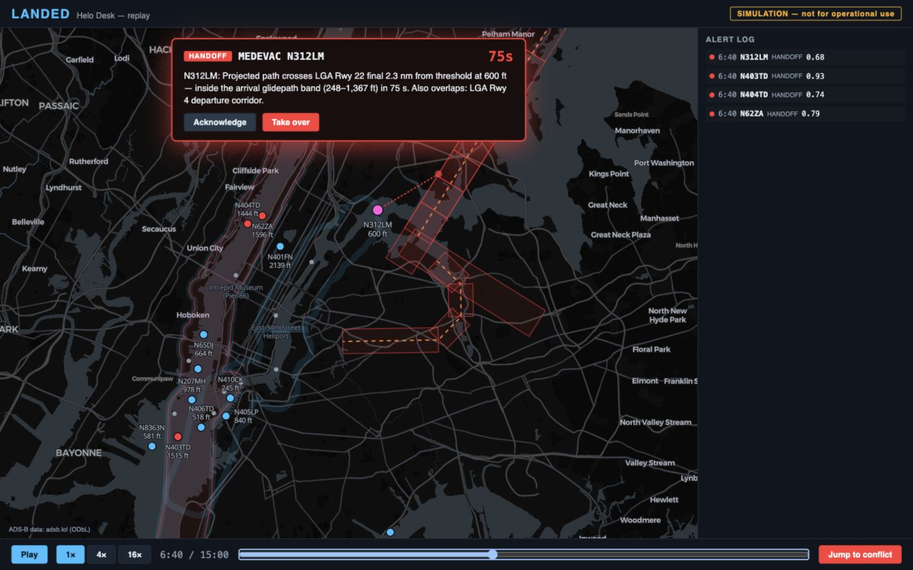
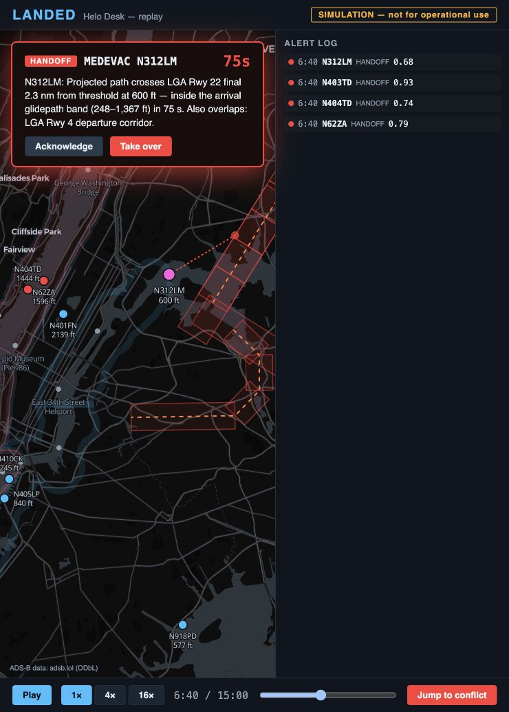

# Landed QA

This runbook covers the replay desk and deterministic speech tests. It does not
certify aviation safety or the accuracy of live speech recognition. All flight
interactions are simulation or replay.

## Automated checks

The `Landed checks` workflow runs on pull requests, pushes to `main` and the
integration branch, and manual dispatch. It has four jobs:

- **App tests, lint, and build:** Node.js 24, `npm ci --ignore-scripts`, Vitest,
  oxlint, and the TypeScript/Vite production build.
- **Speech unit tests (no provider calls):** Python 3.13, uv 0.12.1,
  `uv sync --locked`, Ruff for QA scripts, and deterministic pytest tests.
- **agent tests / server tests (no provider calls):** a two-project matrix using
  each project's lockfile and the offline pytest plugin. The server job also
  starts an isolated loopback server and runs three HTTP acceptance cycles with
  mocked providers.

The speech job loads `qa/offline_pytest.py` before test collection. This plugin
fails outbound socket connections, DNS lookups, and subprocess launches, including
attempts to invoke `gcloud`. It is a regression guard for accidental API use, not a
security sandbox. Dependency installation needs registry access. Test execution
does not use provider credentials, audio caches, or Secret Manager access.

No path filters skip these checks. Repository administrators can select the two
job names as required checks after the workflow has run. This PR does not change
branch protection or repository permissions.

## Reproduce from a fresh checkout

Use a branch containing the app and speech code. The initial `main` commit
`0e98291` contains only the spec, EDA, and reference tree. See
coordination issue #9 for the active
integration branch and ownership. Use a separate worktree when agents are active.

Install Node.js 24 and uv, then run from the repository root:

```sh
npm ci --prefix app --ignore-scripts
npm test --prefix app
npm run lint --prefix app
npm run build --prefix app
uv sync --project speech --locked --python 3.13
uv run --project speech --offline --no-sync ruff check qa
```

Run speech tests from `speech/` so pytest uses the project configuration:

```sh
cd speech
PYTHONPATH=../qa uv run --offline --no-sync python -m pytest -p offline_pytest -q
```

The committed `app/public/data/` assets are sufficient to run the replay desk.
You do not need the ignored 177 MB raw history file, FAA lookups, or cloud keys.
Regenerating geography, replay, audio, and provider evaluations is separate work.

## Start and probe the app

From the repository root, start the development server:

```sh
npm run dev --prefix app -- --host 127.0.0.1 --port 4180 --strictPort
```

In a second terminal at the repository root, run:

```sh
uv run --project speech --offline --no-sync python qa/probe_http.py http://127.0.0.1:4180
```

The probe checks HTTP 200, the Landed app shell, two nonempty replay files, and
four nonempty GeoJSON collections. A missing or invalid asset exits nonzero.
It does not prove JavaScript execution, map rendering, or aircraft behavior.

For the production bundle, build first and replace the dev command with:

```sh
npm run preview --prefix app -- --host 127.0.0.1 --port 4181 --strictPort
```

Probe port 4181 and repeat the browser steps. Authentication is not required by
the replay desk. The map needs Internet access to load CARTO styles, tiles, and
fonts; the committed flight and geography data load from the local server.

## Browser procedure

1. Open the local server URL. Confirm the simulation banner, map, ADS-B credit,
   empty alert log, and a paused `0:00 / 15:00` clock.
2. Click **Play**. Confirm that the clock and aircraft positions advance. Click
   **Pause** and confirm that the clock stops.
3. Click **Jump to conflict**. It seeks to approximately `6:30` and starts playback.
   A real-track Class B handoff can appear before the simulated medevac handoff.
4. Wait for **MEDEVAC N312LM**. Confirm a runway-22 approach reason, 600 ft altitude,
   and a decreasing countdown. Pause before making a decision.
5. Click **Acknowledge**. Confirm the acknowledgement and latency appear in both
   the card and log. This is a UI decision record, not a spoken transmission.
6. Seek to zero. Confirm the log and previous decision clear. Seek to `6:40`
   (`t=400`) and confirm a fresh N312LM handoff. Click **Take over** and confirm
   the card dismisses and the log records `take_over` with latency.
7. Repeat the reset and handoff check. Record each result; do not carry decisions
   from a prior run into the next result.
8. Exercise 4x and 16x playback, including the end of the 15-minute window.
   Confirm playback stops at the end.
9. Inspect a desktop viewport and a narrow panel. Record clipping or overlapping
   text rather than treating a working desktop layout as responsive validation.

## Baseline evidence: 2026-10-11

Tested integration commit **`eb56e22`** in an isolated worktree. CI/QA changes do
not alter the app, speech parser, geometry, or replay assets.

| Check | Result |
|---|---|
| Clean app install with lockfile | Passed; Node.js 24.14.1, npm 11.11.0 |
| App tests | 44 passed across four files |
| App lint and production build | Passed; nonblocking large-bundle warning |
| Locked speech environment | Passed; Python 3.13.14, uv 0.12.1 |
| Speech tests with offline plugin | 81 passed |
| QA script Ruff check | Passed |
| Guard negative controls | Both deliberate socket/subprocess attempts failed before execution |
| Development and production HTTP probes | Passed: 17 real aircraft, one simulated aircraft, 3/14/2/14 geo features |
| Browser: map, banner, local data | Passed; external basemap rendered |
| Browser: handoff repeatability | Passed 3/3 checks: continuous jump/play, then two reset/seek checks |
| Browser: acknowledgement, take-over, seek reset | Passed |
| Browser: 4x/16x controls and end of window | Passed; stopped at `15:00` after accelerated playback |
| Production preview | Map and N312LM handoff rendered at `t=400` |
| Browser console in dev and production | Failed: triangle heading icon cannot decode; circle markers and labels render |
| Desktop layout, 1440 × 900 | Card and log legible and separate |
| Narrow layout, 671 × 1035 | Failed: card overlaps sidebar text |

The two reset/seek checks showed a N312LM handoff at `6:40`, 600 ft, with about
75 s to entry. The card described modeled protected-volume entry at 2.3 nm from
the threshold. Do not equate this with the separate centerline-crossing distance
used in pitch copy. Seeking resets engine history, so a seek-only confidence
value need not equal the confidence after continuous playback.





The app owner has the layout and map-attribution findings in
issue #1.
The visible credit names adsb.lol while MapLibre attribution is disabled; the
CARTO/OSM credit needs owner review. No app-owned paths were edited for this PR.
The console also reports `InvalidStateError: The source image could not be decoded`
and a missing `triangle` image. `MapView.tsx` loads the heading symbol from an
inline SVG via `map.loadImage`; the heading-symbol path needs owner review.

## Remaining integration acceptance

At the tested commit, `server/`, `agent/`, and `scenarios/` are absent from the
pushed tree. Track their landing commits on
issue #18. The checks above cannot
certify a complete voice workflow or all five scripted scenarios.

| Dependency | Evidence needed after landing |
|---|---|
| #10: server and parsed-call integration | A call reaches the desk; stated intent affects projection; keys stay server-side |
| #4: bounded voice agent | Spoken input is a rendered template; arm delay; expired proposals never send; emergency locks silent |
| #5 and #17: scenarios and scoreboard | S1 to S6 run 3/3 (7/7) with expected/actual action, trigger, latency, and decision records |
| #15: corridor rules | Altitude and shoreline deviations cause the expected handoff |
| #16: emergency gate | Squawk and low-confidence emergency paths bypass routine parsing and hand off |
| #6 and #8: pitch and submission | Copy matches tested behavior, lead time, data window, and evaluation limits |

Real-audio ASR accuracy, new model comparisons, and new data-source validity are
separate from the deterministic unit tests. Use a held-out audio set and report
callsign errors, emergency recall, latency, and confidence calibration before
using model comparisons in the pitch. Synthetic TTS scores alone are insufficient.

Public release remains gated by
issue #7, including repository-history
cleanup. This QA work does not merge, publish, rewrite history, or claim operational
aviation readiness.

## Agent and server follow-up: 2026-10-11

Tested integration commit **`1f8e037`**, after the voice agent/server and PR #28
landed. The baseline above remains historical evidence for `eb56e22`.

| Check | Result |
|---|---|
| App tests | 53 passed, including voice-state tests |
| Agent tests, offline guard enabled | 73 passed |
| Server tests, offline guard enabled | 12 passed; one Starlette test-client deprecation warning |
| HTTP acceptance with mocked providers | All checks passed in three consecutive cycles |
| Browser at `http://127.0.0.1:4182/` | Connected agent, pending approval, controller approval audit, emergency lock, simulated controller transmit, and unlock verified |

The server tests cover arm delay, expiry withholding, editing/re-arming, rejection,
engine handoff, emergency lock/suppression, independent squawk detection, retained
audit records, replay rewind, and WebSocket event delivery. They use injected model
and audio stubs, not Gemini calls.

### Reproduce provider-free HTTP acceptance

From the repository root, install the locked server environment:

```sh
uv sync --project server --locked --python 3.13
```

Start the QA-only server in one terminal:

```sh
cd server
PYTHONPATH=../qa uv run --offline --no-sync uvicorn mock_server:make_app --factory --host 127.0.0.1 --port 8788
```

In another terminal at the repository root, run:

```sh
uv run --project server --offline --no-sync python qa/check_server.py
```

The checker refuses non-loopback URLs and requires the mock server's `/qa-mode`
marker before sending data. It resets the isolated server and runs three cycles
of routine proposals, protected-volume handoff, weather handoff, callsign
clarification/escalation, early approval rejection, armed approval, expired audio
withholding, emergency silence, and audit retention after reset. It takes about
35 seconds because approval expiry uses the real clock.

`qa/mock_server.py` uses the real server, policy, templates, and audit code with a
deterministic template selector and a valid **silent WAV** generator. Its cache
and audit files live in a fresh temporary directory. These fixtures exercise
transport and control flow; they measure neither speech intelligibility nor
provider accuracy or latency. Do not record the mocked server as a working voice
demo, and do not point another agent's browser or scenario runner at it while the
checker is running.

For browser QA against the same mock server, use a separate frontend port:

```sh
VITE_LANDED_SERVER=http://127.0.0.1:8788 npm run dev --prefix app -- --host 127.0.0.1 --port 4182 --strictPort
```

The frontend should show a connected agent, receive proposals over WebSocket,
and display pending approvals, audit entries, and the emergency lock banner.
Keep audio disabled: the fixture contains silence, not synthesized speech.

Browser validation used the A1 fixture from `server/scripts/play_scenario.py`
against port 8788. Clicking **Approve** removed the card and appended an
`approve controller` audit record. Injecting simulated ADS-B squawk 7700 showed
the locked-silent banner and optional simulated ops proposal. **TRANSMIT** added
a `human_transmit controller` record; **Unlock agent** removed the banner.
This follow-up used a 1280×720 viewport. The earlier narrow-viewport overlap
finding remains open with the app owner in #1; it was not revalidated here.
Screenshot: [mock emergency](../qa/mock-emergency.jpg).
The original production-preview app at port 4181 was not changed.
