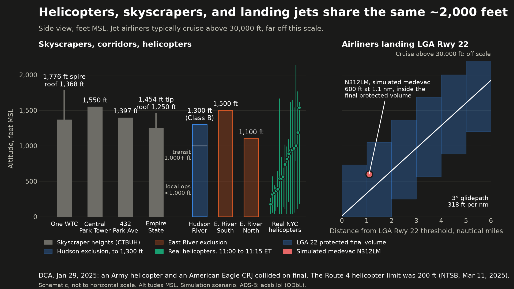

# Landed: pitch deck (8 slides)

Format: one slide per section. Sources live in the speaker notes. Labels: **BUILT** (merged to the integration branch), **IN PROGRESS** (#5, #10 minimal), **PLANNED**. Update labels as PRs land. Every demo screen is labeled REPLAY or SIM. Landed is simulation only and never transmits.

---

## 1. Washington, DC, January 29, 2025
- An Army Black Hawk and PSA Airlines flight 5342 (American Eagle) collided on short final to Reagan National. 67 people died.
- One controller was on the combined local and helicopter position. The two aircraft were on different frequencies.
- The conflict alert had been active for about 26 seconds before the collision.

<small>Route 4 max 200 ft, per NTSB. Figure from docs/figures/altitude_profile.png (integration branch; sources in altitude_profile_SOURCES.md).</small>

Notes:
- Collision ~2048 EST, PAT25 (UH-60L) and PSA Airlines flight 5342 (CRJ700), 67 fatalities (64 airplane, 3 helicopter). https://www.ntsb.gov/investigations/Pages/DCA25MA108.aspx
- Tower had five controllers; HC and LC were combined at 1540. Tower 119.1 for the CRJ, helicopter 134.35 for PAT25. NTSB AIR-26-02 (adopted Jan 27, 2026).
- Conflict alert activated at 2047:33, 26 s before the collision; audible in the background of the tower's 2047:39 call. AIR-26-02.
- Probable cause includes "inadequate traffic advisories, and the lack of safety alerts to both flight crews", attributed to the tower team's degraded performance under high workload. NTSB case page.
- Route 4 max 200 ft, about 75 ft separation. NTSB press release, Mar 11, 2025. Collision ~278 ft msl, AIR-26-02.
- Positions were combined, which FAA facility rules allow. Do not quote JO 7210.3 text (not opened).
- Framing: "Landed is designed to raise an earlier alert, but nobody has tested what would have happened at DCA." Never claim it would have prevented the accident. No wreck imagery.

## 2. The gap: helicopter traffic nobody is required to watch
- NYC river routes below Class B: pilots self-announce on a shared frequency, no ATC contact required.
- Controllers get involved when a helicopter enters Class B or LGA's surface area.
- Combining helicopter and runway positions is allowed, and common when traffic or staffing is light.
- A commenter on r/ATC: "Medevac helicopters coming in and out of the airspace and not crossing any arrival or departure paths? Go for it Ai! Take that over today. Repetitive task with low risk, seems like a good trial."

Notes:
- 14 CFR 93.351(c), Hudson River and East River exclusions. CTAF 123.05 (Hudson) and 123.075 (East River) verified on the current FAA New York VFR Helicopter Route Chart (Sep 3, 2026 edition): "All aircraft self announce on 123.075 for the East River and 123.05 for the Hudson River." https://aeronav.faa.gov/visual/09-03-2026/PDFs/New_York_Heli.pdf
- r/ATC quote: VERIFIED in a browser, https://www.reddit.com/r/ATC/comments/1vmyqe1/comment/p3gkv7x/. Say "a commenter on r/ATC"; do not name the user or call them a controller.

## 3. Landed
- On a simulated desk, Landed handles routine medevac check-ins and hands anything risky to the controller (BUILT on the integration branch, #4).
- Flags trouble early: projected conflicts with a reason and a countdown (BUILT).
- The human makes every hard call: priority, sequencing and clearances stay with the controller. Landed only handles routine acknowledgements.
- Like highway driver assist: handles the long boring stretch, says "take the wheel" before the hard interchange.
- Simulation only. Never transmits.

Notes: Built today: replay, 90 s path projection, alert cards with reason, confidence and countdown. Voice agent (#4) is built: fixed phrase list, approval cards, emergency lock, audit log.

## 4. Demo (REPLAY + SIM)
- REPLAY: 17 real helicopters, Sat Oct 10, 2026, 11:00 to 11:15 ET, from adsb.lol.
- SIM S1: a clean medevac flight up the East River. Routine check-in and acknowledgement (scripted scenario, #5).
- SIM S2: N312LM at 600 ft toward the College Point area crosses the LGA Rwy 22 final 1.1 nm out. Alert about 84 seconds before entry, with a reason and a countdown (BUILT). A DCA-like situation: a helicopter crossing an airliner's short final.
- SIM S5: MAYDAY. Landed speaks once on the sim channel, "controller taking over", then goes silent (emergency lock BUILT, #4; scenario #5).

Notes:
- N312LM is a simulated flight, not a real aircraft. 600 ft at 1.1 nm is roughly 200 ft above a 3 degree glidepath (about 360 to 410 ft at 1.1 nm, depending on threshold crossing height); still inside the 0 to 730 ft protected band, inside the approximate protected volume (geo files mark it approximate).
- Lead time is measured in the build (~84 s). Do not quote the old lead-time comparisons.
- Hypothetical framing, if used aloud: "picture one controller on a busy shift, arrivals plus three medevacs." Say it is hypothetical; the demo is the Saturday replay.

## 5. Why a controller could trust it (BUILT)
- Every alert has a plain English reason and a confidence score (BUILT).
- Built: fixed phrase list, the model picks and never composes; low confidence means an approval card or a handoff; every decision logged.
- 0 false approach or departure handoffs across 17 real helicopters in the demo window (Sat Oct 10, 11:00 to 11:15 ET); six helicopters above the Hudson Class B floor were flagged for the controller (engine real-traffic snapshot test).

Notes: The approval card uses A/E/R keys with a 1 s arm delay and 10 s expiry and is never auto-sent; handoff triggers are tested in agent/tests/test_agent.py. Speech confidence below 0.8 would catch 92.9% of critical errors at a 32% handoff rate (speech/RESULTS.md); the agent's tier thresholds are design choices, not tuned on real NYC audio.

## 6. Gemini
| Job | Gemini feature | Status |
|---|---|---|
| Radio audio to text | gemini-3.8-flash transcription | Built |
| Radio call to JSON with confidence and reason | gemini-3.5-flash-lite structured output (100% valid JSON, median 0.89 s) | Built |
| Simulated pilot voices | gemini-3.8-flash-lite-tts | Built |
| Reply template and slots | Function calling (forced choose_template / handoff) | Built |
| Speaking the exact approved text | Gemini TTS, verbatim agent voice | Built (0.6 to 1.3 s warm) |

Notes: Alert reasons are code templates, not Gemini. Sources: speech/RESULTS.md, #4 status comment. Update statuses after the integration merge.

Router (shadow mode, say verbatim if asked): "Every radio call is also routed by a typed decision model (OpenAI Decisions) that returns a label with a probability in about a third of a second. It runs in shadow mode while we calibrate thresholds; hard safety rules stay in code."

## 7. Prior art
- MayDay (UC Berkeley AI Hackathon 2025), Squawk (Devpost 2026), ACRP miscommunication detection, SESAR HAAWAII.
- Cited from their public descriptions. Ideas only, no code.
- What is new here: a bounded agent that hands off before arrival and departure paths, checked against real ADS-B.

## 8. What's next
- Enforce the SFRA corridor rules (#15) and calibrate the decision router on labeled calls before it leaves shadow mode (#31).
- Verify and replace the approximate geometry with exact 14 CFR 93.350 boundaries and FAA plates.
- Measure false alarms across many replay days; weekday medevac data.
- Trial at a quiet non-towered field first.
- "Takes the routine. Flags trouble early. The human makes every hard call."
